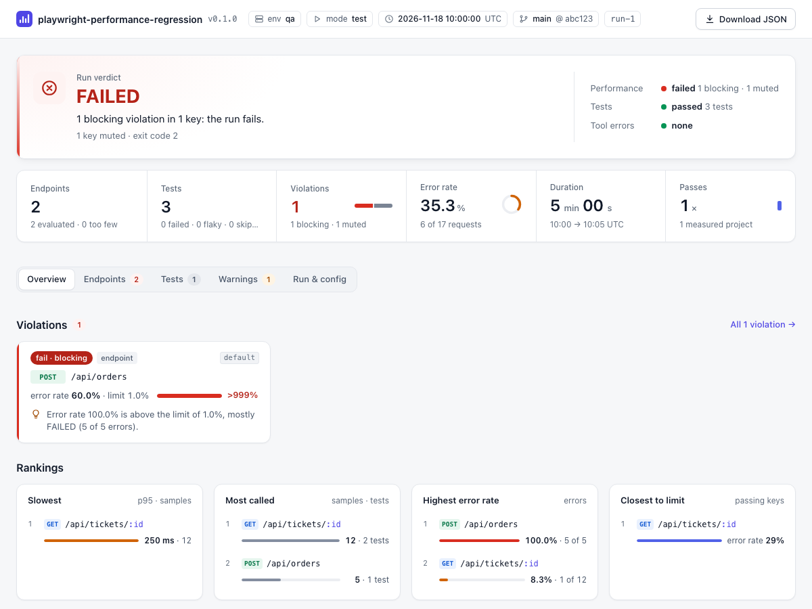

# playwright-performance-regression

Catch backend performance regressions from the Playwright tests you already have.

> **Pre-release.** `0.1.0-next.N` versions are published under the `next` tag: install with
> `npm init playwright-performance-regression@next` or
> `npm install --save-dev playwright-performance-regression@next`. Until `0.1.0`, the API, file
> formats and CLI may still change.



## How it works

1. **Measures** the backend requests your browser makes while your existing e2e tests run, in a
   separate measurement run (`pw-perf test`), with every test repeated a few times.
2. **Groups** the requests into endpoint keys such as `GET /api/orders/:id`, and computes
   statistics per key: median, p95, p99, error rate and more.
3. **Derives thresholds** from a run and writes them to JSON files that you review and commit like
   code.
4. **Fails the run** when an endpoint gets slower or returns more errors than its thresholds
   allow, with a console summary and a self-contained HTML report.

Your normal `npx playwright test` runs are not changed.

## Install

```sh
npm init playwright-performance-regression
```

This installs the package as a dev dependency and starts a short guided setup (`pw-perf init`). It
shows a diff of every change before writing anything: it wraps your Playwright config, wraps your
`test` object or switches test imports, creates `pw-perf.config.ts`, adds `perf:test` and
`perf:thresholds` scripts, ignores `perf-results/`, and can add a CI job. `pnpm create` and
`yarn create` work too (Yarn 2 or later; Yarn 1 cannot install a specific version such as
`@next` with `yarn create`); `-- --yes` accepts the defaults without questions. The guided
setup speaks English, Spanish, French, Polish, Italian, Ukrainian and Russian (`--lang <code>`).

<details>
<summary>Manual setup</summary>

```sh
npm install -D playwright-performance-regression
```

Wrap the Playwright config:

```ts
// playwright.config.ts
import { defineConfig } from '@playwright/test';
import { withPerf } from 'playwright-performance-regression/config';

export default withPerf(defineConfig({/* your config, unchanged */}));
```

Then either wrap your own test object:

```ts
// fixtures.ts
import { test as base } from '@playwright/test';
import { withPerfFixtures } from 'playwright-performance-regression/fixture';

export const test = withPerfFixtures(base.extend({/* your fixtures */}));
export { expect } from '@playwright/test';
```

or, if your tests import `test` straight from `@playwright/test`, switch that import:

```ts
import { test, expect } from 'playwright-performance-regression/test';
```

Optionally add `pw-perf.config.ts` and pass it as the second argument of `withPerf()`; see
[Configuration](docs/configuration.md).

</details>

Projects with their own fixtures, several test objects, `mergeTests`, playwright-bdd, config
wrappers or custom reporters: see [Adopting the package in an existing project](docs/adoption.md).

## Quick start

```sh
npm run perf:thresholds   # measure and write the thresholds files
git add perf-thresholds.*.json && git commit -m "test: add performance thresholds"
npm run perf:test         # measure again and compare with the thresholds
```

Without the scripts: `npx pw-perf thresholds` and `npx pw-perf test` (add `--grep @perf` to
measure only the tests tagged `@perf`).

Derive thresholds on the same machines that run the check, usually your CI runners, and bring them
to your repository with `pw-perf thresholds --from <report.json>`. Thresholds measured on a laptop
do not fit CI. See [Thresholds](docs/thresholds.md).

The result is printed in the terminal and written to `perf-results/report.json` and
`perf-results/report.html`.

## Custom measurements

Time a user-visible step that spans several requests, or anything else in the test:

```ts
test('checkout', async ({ page, perf }) => {
  await page.goto('/cart');
  await perf.measure('checkout:load-cart', async () => {
    await page.getByRole('button', { name: 'Checkout' }).click();
    await page.getByText('Order summary').waitFor();
  });
});
```

`perf.start(name)` and `perf.end(name)` do the same without a callback. Custom measurements get
their own thresholds file and checks. Coming from `playwright-performance`? `perf.sampleStart()`
and `perf.sampleEnd()` are aliases of `start()` and `end()`.

## CI

A GitHub Actions job that measures pull requests and runs every night:

```yaml
name: Performance
on:
  pull_request:
  schedule:
    - cron: '0 3 * * *'
jobs:
  perf:
    runs-on: ubuntu-latest
    timeout-minutes: 60
    steps:
      - uses: actions/checkout@v7
      - uses: actions/setup-node@v7
        with:
          node-version: 22
          cache: npm
      - run: npm ci
      - run: npx playwright install --with-deps chromium
      # A tagged subset on pull requests, the full measured suite at night.
      - run: npx pw-perf test ${{ github.event_name == 'pull_request' && '--grep @perf' || '' }}
      - uses: actions/upload-artifact@v7
        if: always() # the report matters most when the run fails
        with:
          name: perf-results
          path: perf-results/
```

Exit codes: **0** no blocking regression, **2** performance regression, **3** tool or config error
(the measurement itself is not trustworthy). Recipes for GitLab CI, Jenkins and Azure Pipelines,
with code 2 as a soft failure where the platform supports it: [CI](docs/ci.md).

## Limitations

- REST only: every GraphQL query goes to the same endpoint key.
- Only requests made by the browser are measured. Tests that use only the `request` fixture, and
  calls through `page.request` or `context.request`, record nothing.
- Only Chromium projects are measured by default. Firefox and WebKit are best effort.
- The measurement run is separate from your normal run, uses one worker and repeats every test,
  so it is slow: measure a subset (`--grep @perf`, `--project`).
- Repeated tests that create data can collide with each other; make the data unique.
- In manual mode (`PW_PERF_MODE=test npx playwright test`), a `--reporter` flag replaces the
  package reporter and nothing is reported. Use `pw-perf test`.

## Privacy

No telemetry. The package never makes network requests.

What ends up where:

- **Thresholds files and `report.json` / `report.html`** contain normalized endpoint keys: numbers,
  UUIDs, long hex strings, tokens, mixed-case ids and e-mail addresses in the path are replaced
  with `:id` or `:email`, and query values are dropped (only parameter names stay). Path segments
  that match none of these patterns, such as user names, stay in the key; add patterns with
  `keys.extraIdPatterns`. The report also contains test titles, file names, the operating system, CPU model
  and CI metadata (commit, branch, build URL).
- **Raw URLs** go into the report only when you set `report.rawUrls: true`.
- **Playwright's own report** gets one attachment per test with the full URLs of the measured
  requests.

**Before you share a report** outside your team, check the keys for personal data and remember
that Playwright's HTML report and traces contain the full URLs.

## Compatibility

|                   | Supported                                                                     |
| ----------------- | ----------------------------------------------------------------------------- |
| Node.js           | 22.18 or newer (22, 24, 26)                                                   |
| Playwright Test   | 1.57 or newer (`@playwright/test` is a peer dependency)                       |
| Operating systems | Linux, macOS, Windows                                                         |
| Browsers          | Chromium (including Chrome and Edge channels); Firefox and WebKit best effort |
| Module formats    | ESM and CommonJS configs; TypeScript configs loaded by Playwright             |

## Documentation

- [Configuration](docs/configuration.md): every option with its default
- [CLI](docs/cli.md): commands, options and exit codes
- [Adoption](docs/adoption.md): existing projects, choosing tests, sample counts
- [Thresholds](docs/thresholds.md): deriving, reviewing, locking and muting
- [CI](docs/ci.md): recipes for GitHub Actions, GitLab CI, Jenkins and Azure Pipelines
- [Troubleshooting](docs/troubleshooting.md): every warning and error code
- [FAQ](docs/faq.md) · [Upgrading and uninstalling](docs/upgrading.md)
- [Examples](examples): a basic project and one with setup projects and own fixtures

## Security

Please report vulnerabilities privately through
[GitHub private vulnerability reporting](https://github.com/Meser6/playwright-performance-regression/security/advisories/new),
not in public issues.

## Contributing

Issues and pull requests are welcome. The project uses pnpm, Conventional Commits and squash
merges; `pnpm lint`, `pnpm typecheck` and `pnpm test` (after `pnpm build`) must pass. Releases
follow [RELEASING.md](RELEASING.md).

## License

[MIT](LICENSE)
